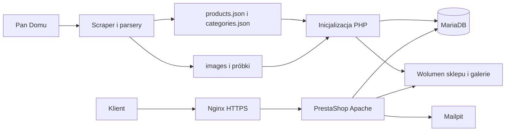

# Architektura

## Komponenty

PrestaShop 8.2.8 działa na PHP 8.1 i Apache w usłudze `shop`. MariaDB 10.11.14 przechowuje dane sklepu w wolumenie `db_data`. Pliki instalacji, galerie, cache i dziennik inicjalizacji znajdują się w `shop_data`. Nginx udostępnia lokalne HTTPS i przekierowuje HTTP. Mailpit odbiera SMTP na porcie 1025 i udostępnia skrzynkę na 8025.

Usługa `certificates` sprawdza eksport oraz zdjęcia i przygotowuje parę klucza z certyfikatem. Usługa `bootstrap` uruchamia bezpieczne wznowienie, korzystając z tego samego wolumenu sklepu. Kontrola gotowości działa jako `www-data`, aby cache miał właściciela zgodnego z Apache.

## Przepływ danych

## Odpowiedzialności kodu

`scraper/Scrapping_products` odkrywa drzewo, przechodzi paginację i weryfikuje ceny rzeczywistych kombinacji. `scraper_elements` odczytuje pola HTML. Modele Pydantic określają eksport, a `catalog_files.py` zapisuje go atomowo. Moduł obrazów normalizuje JPEG i pakuje lokalne zdjęcia.

`deploy/init/lib/source.php` odpowiada za kontrakt źródła i ceny dziesiętne BCMath. `prestashop.php` łączy kod z natywnymi klasami sklepu. Pozostałe biblioteki planują, zapisują i sprawdzają poszczególne obszary. Skrypty CLI są publicznymi punktami wejścia. Pliki `content/*.html` zawierają początkowe treści CMS z tokenami.

Referencje produktów mają postać `pandomu-ID`, a kombinacji `pandomu-ID-combination-ID`. Zdjęcia są mapowane przez sklep, źródłowy ID i hash URL w tabeli `ps_import_image_map`. Zapis ID poprzedza generowanie plików, co umożliwia wznowienie przerwanej galerii.

## Moduł cookies

`shopcookieinfo` rejestruje `displayAfterBodyOpeningTag` i `actionFrontControllerSetMedia`. PHP tworzy komunikat oraz odnośnik CMS, JavaScript obsługuje zamknięcie, a CSS jego układ. Cookie zamknięcia jest odrębny dla sklepu i ważny 180 dni. Pliki autorskiego modułu są synchronizowane z obrazu podczas inicjalizacji. Ustawienia istniejącego modułu pozostają zachowane przy wznowieniu.

## Trwałość i aktualizacje

Restart kontenera uruchamia serwer z zachowaniem konfiguracji. Wspólną konfigurację i import wykonuje inicjalizator. Skrypty `configure-*.php` oraz importery pozostają dostępne do jawnych aktualizacji. Transakcje wykorzystują natywne klasy PrestaShop. Hooki modułów mogą wykonać `TRUNCATE` i zatwierdzić wcześniejsze zapisy, dlatego dziennik oraz mapowania uwzględniają częściowe wykonanie.
